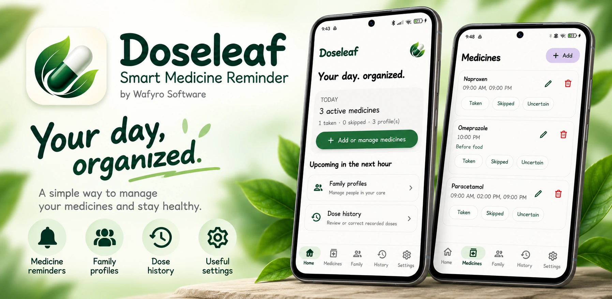

# Doseleaf

**Smart Medicine Reminder** — an offline-first Android medicine reminder by **Wafyro Software**.

Doseleaf helps users organise medicine schedules for themselves and family members while keeping records on-device.

> **Development status:** This is a development source snapshot. The Android Studio build and real-device behaviour have not been verified in this environment. Please compile and test before using it for real medication reminders or publishing a release.

## Included in this source

- Native Android app using Kotlin, Jetpack Compose, Material 3 and Room/SQLite.
- Local-first storage; no backend and no automatic cloud sync.
- First-run personal-name setup for the default Self profile and a first-run guide.
- Medicine add/edit, multiple daily reminder times with Android's 12-hour AM/PM picker, expiry date, optional food timing and custom minute offset.
- Optional prescription-photo attachment using Android's document picker; the URI is stored locally. The original image file is not embedded in JSON backups, and a URI may not work after moving a backup to another device.
- Family profile add/edit/delete; the default profile cannot be deleted. When deleting a non-default profile, active medicines are moved to Recycle Bin and their reminders are cancelled; history records are retained.
- Medicine recycle bin with restore and permanent-delete confirmation.
- Reminder notifications with alarm tone, vibration preference, a full-screen alarm activity, Snooze, Stop, Taken and Skip controls. Full-screen display and sound are subject to Android OS policy and user permissions.
- Settings categories that open separate subpages for reminders, language, data/backup, permissions and help/about.
- Local JSON backup/restore, CSV history export and date-range PDF reports; profile, medicine-name and status filters are available for history exports. Also includes inventory ledger and expiry-date display.
- Google Drive backup entry using Android's Save Document flow. Choose Google Drive as the destination if the provider is installed and available; this is a manual file export, not cloud sync.
- Transparent Doseleaf capsule-and-leaf logo resources, launcher icon and monochrome notification icon.
- MIT licence, changelog, build-status notes and `.gitignore`.

## Known gaps / release blockers

- Complete Bangla localisation is not finished; some screen copy remains English.
- Expiry push notifications and a fully automated test suite are not implemented yet.
- Automated tests, full database migration tests and multi-device QA have not been performed.
- Reminder delivery depends on Android version, exact-alarm access, notification permission/channel settings, battery management and Do Not Disturb. No app can guarantee sound or override Silent/DND on every device.
- The app is not a medical professional and does not validate whether the entered medicine, dose or food instruction is clinically appropriate.

## Requirements

- Android Studio with a compatible Android SDK.
- JDK 17.
- Gradle compatible with the Android Gradle Plugin declared in `app/build.gradle.kts`.
- Internet access for the initial dependency sync.

## Build in Android Studio

1. Clone or download this repository.
2. Open the project root (the directory containing `settings.gradle.kts`) in Android Studio.
3. Allow Gradle sync to finish.
4. Run `:app:assembleDebug` or choose **Build → Assemble Project**.
5. If the build succeeds, the debug APK is normally at `app/build/outputs/apk/debug/app-debug.apk`.

This source snapshot does not include a Gradle wrapper. For reproducible public builds, generate and commit a wrapper using a Gradle version compatible with the configured Android Gradle Plugin.

## Version

- Application ID: `com.wafyro.doseleaf`
- Version name: `1.1.0`
- Version code: `2`
- Room database schema: `5`

The Android app version is configured in `app/build.gradle.kts`. Historical `1.0.0` entries below describe the earlier release and are retained for release history.

## Privacy

Profile, medicine, schedule, inventory and history records are intended to remain on the device. Backup/export only happens when initiated by the user. Choosing Google Drive as a save destination stores the exported file through Android's document provider; it does not enable background sync. Do not include real patient names, prescriptions or private health data in public issues.

## Open-source licence

Licensed under the [MIT License](LICENSE). Copyright (c) 2026 Afee Muhammod Wafy.

## Contributing

Issues and pull requests are welcome. Include Android version, device manufacturer and the exact Gradle error when reporting technical issues. Never attach real prescriptions or personally identifying health information. Changes to reminders, database migrations and backup/restore should be tested carefully.

## Safety

Doseleaf is a scheduling and record-keeping tool, not a medical professional. Enter medicine instructions from the prescription or healthcare professional. The app does not recommend doses or decide whether a medicine should be taken before/after food. A missing notification does not prove a dose was missed.

## Historical source update (1.0.0)

The following notes describe the earlier `1.0.0` source snapshot (`versionCode` `1`); the current release is `1.1.0` (`versionCode` `2`).

### Medicine entry
- Add Medicine opens as a full-screen page rather than a compact dialog.
- Select 1–4 reminders per day; the selected count controls the number of time fields.
- Profile selection is explicit and required before saving a new medicine.
- Food timing supports None, Before food, With food, and After food, including an optional interval for before/after-food reminders.
- Dose and expiry date inputs are not shown in the add/edit medicine UI. Existing database fields are retained for compatibility with existing local installations.

### Onboarding and navigation
- First-run name entry remains required; whitespace-only names are rejected.
- The how-to guide no longer presents a Skip control.
- Settings subpage back control is an arrow-only control, and system Back uses a page-history stack.

### Reminders
- Reminder notifications provide Taken and Skip actions that open the dose action flow.
- The receiver continues attempting to schedule the next daily occurrence even when notification permission is unavailable; posting a notification is permission-guarded.
- Exact-alarm scheduling uses Android's exact-alarm permission when available and a best-effort inexact fallback otherwise. Android settings, battery restrictions, and notification permissions can still affect delivery.

### Verification status
- Source changes were made in this ZIP, but an Android Gradle build and on-device alarm/notification test have **not** been run in this environment. Do not treat this archive as a verified production release until it builds and is tested on a real Android device.

## Reminder and alarm behavior (updated source)

- Medication reminders are scheduled with `AlarmManager`; exact scheduling is used when Android grants exact-alarm access, with an inexact fallback otherwise.
- Android 13+ notification permission and Android 12+ exact-alarm access may be required. The app must be allowed to post notifications and the device's alarm volume must be audible.
- `BOOT_COMPLETED`, time-change, and time-zone-change broadcasts trigger restoration of active medicine schedules from the local Room database.
- Reminder notifications expose Taken and Skip actions and use a dedicated monochrome status-bar icon. Android decides whether a full-screen alarm activity may appear over the lock screen; this cannot be guaranteed on every device or OEM configuration.
- Dose actions from the alarm activity are accepted only within 30 minutes of the scheduled time and check existing dose logs to avoid a second Taken/Skipped entry for the same scheduled occurrence.

## Current UI changes

- The Add Medicine screen no longer preselects a reminder time; each time must be chosen explicitly (`Choose your time`).
- Settings category pages place the back arrow and category title on the same header row.
- The Home medicine card no longer displays the Stock / refill control, and expiry/prescription-photo controls were removed from the medicine form and card UI.
- Existing database columns and legacy inventory/expiry data structures are intentionally retained for compatibility with already-installed local databases. They are not automatically migrated away by this UI update.

## Verification note

This source archive has not been built with Gradle in this environment and has not been verified on a physical Android device. Please run `./gradlew assembleDebug` (or build from Android Studio) and test alarm delivery, reboot restoration, notification actions, and permission flows on the target device before treating it as a release.

## Version 1.1.0 (versionCode 2)

Follow-up UI corrections: profile creation is available in Add Medicine, duplicate system-bar insets were removed from Add/Edit Medicine, and the Medicines-page profile shortcut was removed. See `CHANGELOG.md`.

- Refined the Home upcoming-dose empty state.
- Removed Family Profile and Dose History shortcuts from the Home page; their dedicated destinations remain available.
- Added profile management entry point on the Medicines page, including Create New Profile navigation.
- Added Send Feedback on About Doseleaf, opening the support URL in an external browser.
- Standardized navigation/back behavior and screen spacing where covered by the current implementation.

Build and device verification must be completed in Android Studio; this source update does not claim a verified build.
